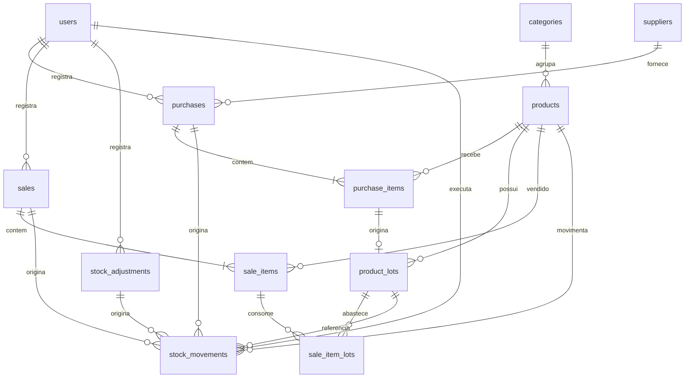

# 03 - Modelo de dados

## 1. Convenções

- MySQL 8.0+, engine InnoDB, charset `utf8mb4`, collation `utf8mb4_unicode_ci`.
- Chaves primárias `BIGINT UNSIGNED AUTO_INCREMENT`.
- Nomes de tabelas e colunas em inglês, no singular ou plural conforme a tabela; interface em português.
- Datas e horas em `DATETIME`; validade em `DATE`.
- Quantidades em `DECIMAL(12,3)`; dinheiro em `DECIMAL(10,2)` ou `DECIMAL(12,2)`.
- Exclusão lógica (`is_active`) para cadastros; movimentações são imutáveis.
- `created_at` e `updated_at` em todos os cadastros.

## 2. Visão geral



## 3. Tabelas

### 3.1 `users`

Usuários internos do sistema.

| Coluna | Tipo | Observação |
| --- | --- | --- |
| `id` | BIGINT UNSIGNED | PK |
| `name` | VARCHAR(120) | Obrigatório |
| `email` | VARCHAR(160) | Obrigatório, único |
| `password_hash` | VARCHAR(255) | Hash gerado por `password_hash` |
| `role` | ENUM('admin','operador') | Padrão `operador` |
| `is_active` | TINYINT(1) | Padrão 1 |
| `created_at`, `updated_at` | DATETIME | Auditoria |

### 3.2 `categories`

| Coluna | Tipo | Observação |
| --- | --- | --- |
| `id` | BIGINT UNSIGNED | PK |
| `name` | VARCHAR(80) | Único |
| `description` | VARCHAR(255) | Opcional |
| `default_controls_lots` | TINYINT(1) | Padrão de lote para novos produtos; 1 em Carnes |
| `is_active` | TINYINT(1) | Padrão 1 |
| `created_at`, `updated_at` | DATETIME | Auditoria |

### 3.3 `suppliers`

| Coluna | Tipo | Observação |
| --- | --- | --- |
| `id` | BIGINT UNSIGNED | PK |
| `name` | VARCHAR(160) | Obrigatório |
| `document` | VARCHAR(20) | CPF/CNPJ opcional |
| `phone` | VARCHAR(30) | Opcional |
| `email` | VARCHAR(160) | Opcional |
| `notes` | VARCHAR(500) | Opcional |
| `is_active` | TINYINT(1) | Padrão 1 |
| `created_at`, `updated_at` | DATETIME | Auditoria |

### 3.4 `products`

| Coluna | Tipo | Observação |
| --- | --- | --- |
| `id` | BIGINT UNSIGNED | PK |
| `category_id` | BIGINT UNSIGNED | FK opcional |
| `name` | VARCHAR(160) | Obrigatório |
| `sku` | VARCHAR(60) | Código interno opcional, único |
| `barcode` | VARCHAR(60) | Código de barras opcional, único |
| `unit` | ENUM('un','kg','g','L','ml','pacote','caixa') | Padrão `un` |
| `sale_price` | DECIMAL(10,2) | Preço atual |
| `cost_price` | DECIMAL(10,2) | Custo médio ponderado atual |
| `min_stock` | DECIMAL(12,3) | Estoque mínimo |
| `current_stock` | DECIMAL(12,3) | Saldo atual desnormalizado |
| `controls_lots` | TINYINT(1) | Exige lote/validade |
| `is_active` | TINYINT(1) | Padrão 1 |
| `created_at`, `updated_at` | DATETIME | Auditoria |

### 3.5 `purchases`

Cabeçalho da compra de reposição.

| Coluna | Tipo | Observação |
| --- | --- | --- |
| `id` | BIGINT UNSIGNED | PK |
| `supplier_id` | BIGINT UNSIGNED | FK opcional |
| `user_id` | BIGINT UNSIGNED | Quem registrou |
| `purchased_at` | DATETIME | Data da compra |
| `document_number` | VARCHAR(80) | Nota/recibo opcional |
| `notes` | VARCHAR(500) | Opcional |
| `total_cost` | DECIMAL(12,2) | Soma dos itens |
| `created_at` | DATETIME | Auditoria |

### 3.6 `purchase_items`

| Coluna | Tipo | Observação |
| --- | --- | --- |
| `id` | BIGINT UNSIGNED | PK |
| `purchase_id` | BIGINT UNSIGNED | FK |
| `product_id` | BIGINT UNSIGNED | FK |
| `quantity` | DECIMAL(12,3) | Maior que zero |
| `unit_cost` | DECIMAL(10,2) | Custo unitário |
| `line_total` | DECIMAL(12,2) | `quantity x unit_cost` |
| `created_at` | DATETIME | Auditoria |

### 3.7 `product_lots`

Lotes de produtos com controle de validade. Cada item de compra gera no máximo um lote.

| Coluna | Tipo | Observação |
| --- | --- | --- |
| `id` | BIGINT UNSIGNED | PK |
| `product_id` | BIGINT UNSIGNED | FK |
| `purchase_item_id` | BIGINT UNSIGNED | FK opcional, único |
| `lot_code` | VARCHAR(80) | Código do lote |
| `expires_at` | DATE | Validade; obrigatória para produtos com lote |
| `initial_quantity` | DECIMAL(12,3) | Quantidade recebida |
| `current_quantity` | DECIMAL(12,3) | Saldo do lote |
| `unit_cost` | DECIMAL(10,2) | Custo do lote |
| `created_at`, `updated_at` | DATETIME | Auditoria |

### 3.8 `sales`

Cabeçalho da venda.

| Coluna | Tipo | Observação |
| --- | --- | --- |
| `id` | BIGINT UNSIGNED | PK |
| `user_id` | BIGINT UNSIGNED | Quem registrou |
| `sold_at` | DATETIME | Data da venda |
| `total_value` | DECIMAL(12,2) | Soma das linhas |
| `status` | ENUM('concluida','cancelada') | Padrão `concluida` |
| `canceled_by` | BIGINT UNSIGNED | FK opcional |
| `canceled_at` | DATETIME | Opcional |
| `cancel_reason` | VARCHAR(500) | Obrigatório ao cancelar |
| `created_at` | DATETIME | Auditoria |

### 3.9 `sale_items`

| Coluna | Tipo | Observação |
| --- | --- | --- |
| `id` | BIGINT UNSIGNED | PK |
| `sale_id` | BIGINT UNSIGNED | FK |
| `product_id` | BIGINT UNSIGNED | FK |
| `quantity` | DECIMAL(12,3) | Maior que zero |
| `unit_price` | DECIMAL(10,2) | Preço no momento da venda |
| `unit_cost` | DECIMAL(10,2) | Custo médio no momento da venda |
| `line_total` | DECIMAL(12,2) | `quantity x unit_price` |
| `created_at` | DATETIME | Auditoria |

### 3.10 `sale_item_lots`

Registra de quais lotes cada item de venda saiu. Permite estorno exato.

| Coluna | Tipo | Observação |
| --- | --- | --- |
| `id` | BIGINT UNSIGNED | PK |
| `sale_item_id` | BIGINT UNSIGNED | FK |
| `product_lot_id` | BIGINT UNSIGNED | FK |
| `quantity` | DECIMAL(12,3) | Maior que zero |
| `created_at` | DATETIME | Auditoria |

### 3.11 `stock_adjustments`

| Coluna | Tipo | Observação |
| --- | --- | --- |
| `id` | BIGINT UNSIGNED | PK |
| `product_id` | BIGINT UNSIGNED | FK |
| `user_id` | BIGINT UNSIGNED | FK |
| `adjustment_type` | ENUM('ajuste_positivo','ajuste_negativo','perda') | Tipo |
| `quantity` | DECIMAL(12,3) | Quantidade absoluta, maior que zero |
| `unit_cost` | DECIMAL(10,2) | Opcional; usado no ajuste positivo com custo informado |
| `reason` | VARCHAR(500) | Obrigatório |
| `created_at` | DATETIME | Auditoria |

### 3.12 `stock_movements`

Livro razão do estoque. Não é editado nem excluído.

| Coluna | Tipo | Observação |
| --- | --- | --- |
| `id` | BIGINT UNSIGNED | PK |
| `product_id` | BIGINT UNSIGNED | FK |
| `product_lot_id` | BIGINT UNSIGNED | FK opcional |
| `movement_type` | ENUM('entrada_compra','saida_venda','estorno_venda','ajuste_positivo','ajuste_negativo','perda') | Tipo |
| `quantity` | DECIMAL(12,3) | Positivo entrada, negativo saída; diferente de zero |
| `balance_after` | DECIMAL(12,3) | Saldo do produto após o movimento |
| `reference_type` | ENUM('purchase','sale','adjustment') | Origem opcional |
| `reference_id` | BIGINT UNSIGNED | ID da origem |
| `user_id` | BIGINT UNSIGNED | Responsável |
| `notes` | VARCHAR(500) | Motivo/observação |
| `created_at` | DATETIME | Data do movimento |

## 4. Invariantes

Estas condições devem ser verdadeiras após cada transação:

1. `products.current_stock >= 0`.
2. Para cada produto, `products.current_stock = SUM(stock_movements.quantity)`.
3. Para produto com `controls_lots = 1`, `products.current_stock = SUM(product_lots.current_quantity)`.
4. Para cada compra, `purchases.total_cost = SUM(purchase_items.line_total)`.
5. Para cada venda, `sales.total_value = SUM(sale_items.line_total)`.
6. Para cada item de venda de produto com lote, `sale_items.quantity = SUM(sale_item_lots.quantity)`.
7. `stock_movements.balance_after` é o saldo do produto imediatamente após o movimento, na ordem cronológica de criação.

## 5. DDL MySQL

```sql
CREATE DATABASE IF NOT EXISTS estoque_churrasco
  DEFAULT CHARACTER SET utf8mb4
  DEFAULT COLLATE utf8mb4_unicode_ci;

USE estoque_churrasco;

CREATE TABLE users (
  id BIGINT UNSIGNED NOT NULL AUTO_INCREMENT,
  name VARCHAR(120) NOT NULL,
  email VARCHAR(160) NOT NULL,
  password_hash VARCHAR(255) NOT NULL,
  role ENUM('admin', 'operador') NOT NULL DEFAULT 'operador',
  is_active TINYINT(1) NOT NULL DEFAULT 1,
  created_at DATETIME NOT NULL DEFAULT CURRENT_TIMESTAMP,
  updated_at DATETIME NOT NULL DEFAULT CURRENT_TIMESTAMP ON UPDATE CURRENT_TIMESTAMP,
  PRIMARY KEY (id),
  UNIQUE KEY uq_users_email (email)
) ENGINE=InnoDB;

CREATE TABLE categories (
  id BIGINT UNSIGNED NOT NULL AUTO_INCREMENT,
  name VARCHAR(80) NOT NULL,
  description VARCHAR(255) NULL,
  default_controls_lots TINYINT(1) NOT NULL DEFAULT 0,
  is_active TINYINT(1) NOT NULL DEFAULT 1,
  created_at DATETIME NOT NULL DEFAULT CURRENT_TIMESTAMP,
  updated_at DATETIME NOT NULL DEFAULT CURRENT_TIMESTAMP ON UPDATE CURRENT_TIMESTAMP,
  PRIMARY KEY (id),
  UNIQUE KEY uq_categories_name (name)
) ENGINE=InnoDB;

CREATE TABLE suppliers (
  id BIGINT UNSIGNED NOT NULL AUTO_INCREMENT,
  name VARCHAR(160) NOT NULL,
  document VARCHAR(20) NULL,
  phone VARCHAR(30) NULL,
  email VARCHAR(160) NULL,
  notes VARCHAR(500) NULL,
  is_active TINYINT(1) NOT NULL DEFAULT 1,
  created_at DATETIME NOT NULL DEFAULT CURRENT_TIMESTAMP,
  updated_at DATETIME NOT NULL DEFAULT CURRENT_TIMESTAMP ON UPDATE CURRENT_TIMESTAMP,
  PRIMARY KEY (id),
  KEY idx_suppliers_name (name)
) ENGINE=InnoDB;

CREATE TABLE products (
  id BIGINT UNSIGNED NOT NULL AUTO_INCREMENT,
  category_id BIGINT UNSIGNED NULL,
  name VARCHAR(160) NOT NULL,
  sku VARCHAR(60) NULL,
  barcode VARCHAR(60) NULL,
  unit ENUM('un', 'kg', 'g', 'L', 'ml', 'pacote', 'caixa') NOT NULL DEFAULT 'un',
  sale_price DECIMAL(10,2) NOT NULL DEFAULT 0.00,
  cost_price DECIMAL(10,2) NOT NULL DEFAULT 0.00,
  min_stock DECIMAL(12,3) NOT NULL DEFAULT 0.000,
  current_stock DECIMAL(12,3) NOT NULL DEFAULT 0.000,
  controls_lots TINYINT(1) NOT NULL DEFAULT 0,
  is_active TINYINT(1) NOT NULL DEFAULT 1,
  created_at DATETIME NOT NULL DEFAULT CURRENT_TIMESTAMP,
  updated_at DATETIME NOT NULL DEFAULT CURRENT_TIMESTAMP ON UPDATE CURRENT_TIMESTAMP,
  PRIMARY KEY (id),
  UNIQUE KEY uq_products_sku (sku),
  UNIQUE KEY uq_products_barcode (barcode),
  KEY idx_products_name (name),
  KEY idx_products_category (category_id),
  CONSTRAINT fk_products_category FOREIGN KEY (category_id)
    REFERENCES categories (id) ON DELETE SET NULL,
  CONSTRAINT chk_products_stock CHECK (current_stock >= 0),
  CONSTRAINT chk_products_sale_price CHECK (sale_price >= 0),
  CONSTRAINT chk_products_cost_price CHECK (cost_price >= 0),
  CONSTRAINT chk_products_min_stock CHECK (min_stock >= 0)
) ENGINE=InnoDB;

CREATE TABLE purchases (
  id BIGINT UNSIGNED NOT NULL AUTO_INCREMENT,
  supplier_id BIGINT UNSIGNED NULL,
  user_id BIGINT UNSIGNED NOT NULL,
  purchased_at DATETIME NOT NULL,
  document_number VARCHAR(80) NULL,
  notes VARCHAR(500) NULL,
  total_cost DECIMAL(12,2) NOT NULL DEFAULT 0.00,
  created_at DATETIME NOT NULL DEFAULT CURRENT_TIMESTAMP,
  PRIMARY KEY (id),
  KEY idx_purchases_date (purchased_at),
  KEY idx_purchases_supplier (supplier_id),
  CONSTRAINT fk_purchases_supplier FOREIGN KEY (supplier_id)
    REFERENCES suppliers (id) ON DELETE SET NULL,
  CONSTRAINT fk_purchases_user FOREIGN KEY (user_id)
    REFERENCES users (id) ON DELETE RESTRICT,
  CONSTRAINT chk_purchases_total CHECK (total_cost >= 0)
) ENGINE=InnoDB;

CREATE TABLE purchase_items (
  id BIGINT UNSIGNED NOT NULL AUTO_INCREMENT,
  purchase_id BIGINT UNSIGNED NOT NULL,
  product_id BIGINT UNSIGNED NOT NULL,
  quantity DECIMAL(12,3) NOT NULL,
  unit_cost DECIMAL(10,2) NOT NULL,
  line_total DECIMAL(12,2) NOT NULL,
  created_at DATETIME NOT NULL DEFAULT CURRENT_TIMESTAMP,
  PRIMARY KEY (id),
  KEY idx_purchase_items_purchase (purchase_id),
  KEY idx_purchase_items_product (product_id),
  CONSTRAINT fk_purchase_items_purchase FOREIGN KEY (purchase_id)
    REFERENCES purchases (id) ON DELETE RESTRICT,
  CONSTRAINT fk_purchase_items_product FOREIGN KEY (product_id)
    REFERENCES products (id) ON DELETE RESTRICT,
  CONSTRAINT chk_purchase_items_quantity CHECK (quantity > 0),
  CONSTRAINT chk_purchase_items_cost CHECK (unit_cost >= 0),
  CONSTRAINT chk_purchase_items_total CHECK (line_total >= 0)
) ENGINE=InnoDB;

CREATE TABLE product_lots (
  id BIGINT UNSIGNED NOT NULL AUTO_INCREMENT,
  product_id BIGINT UNSIGNED NOT NULL,
  purchase_item_id BIGINT UNSIGNED NULL,
  lot_code VARCHAR(80) NOT NULL,
  expires_at DATE NULL,
  initial_quantity DECIMAL(12,3) NOT NULL,
  current_quantity DECIMAL(12,3) NOT NULL,
  unit_cost DECIMAL(10,2) NOT NULL,
  created_at DATETIME NOT NULL DEFAULT CURRENT_TIMESTAMP,
  updated_at DATETIME NOT NULL DEFAULT CURRENT_TIMESTAMP ON UPDATE CURRENT_TIMESTAMP,
  PRIMARY KEY (id),
  UNIQUE KEY uq_product_lots_purchase_item (purchase_item_id),
  KEY idx_product_lots_product (product_id),
  KEY idx_product_lots_expiry (expires_at),
  CONSTRAINT fk_product_lots_product FOREIGN KEY (product_id)
    REFERENCES products (id) ON DELETE RESTRICT,
  CONSTRAINT fk_product_lots_purchase_item FOREIGN KEY (purchase_item_id)
    REFERENCES purchase_items (id) ON DELETE SET NULL,
  CONSTRAINT chk_product_lots_initial CHECK (initial_quantity > 0),
  CONSTRAINT chk_product_lots_current CHECK (current_quantity >= 0),
  CONSTRAINT chk_product_lots_cost CHECK (unit_cost >= 0)
) ENGINE=InnoDB;

CREATE TABLE sales (
  id BIGINT UNSIGNED NOT NULL AUTO_INCREMENT,
  user_id BIGINT UNSIGNED NOT NULL,
  sold_at DATETIME NOT NULL,
  total_value DECIMAL(12,2) NOT NULL DEFAULT 0.00,
  status ENUM('concluida', 'cancelada') NOT NULL DEFAULT 'concluida',
  canceled_by BIGINT UNSIGNED NULL,
  canceled_at DATETIME NULL,
  cancel_reason VARCHAR(500) NULL,
  created_at DATETIME NOT NULL DEFAULT CURRENT_TIMESTAMP,
  PRIMARY KEY (id),
  KEY idx_sales_date (sold_at),
  KEY idx_sales_status (status),
  CONSTRAINT fk_sales_user FOREIGN KEY (user_id)
    REFERENCES users (id) ON DELETE RESTRICT,
  CONSTRAINT fk_sales_canceled_by FOREIGN KEY (canceled_by)
    REFERENCES users (id) ON DELETE SET NULL,
  CONSTRAINT chk_sales_total CHECK (total_value >= 0)
) ENGINE=InnoDB;

CREATE TABLE sale_items (
  id BIGINT UNSIGNED NOT NULL AUTO_INCREMENT,
  sale_id BIGINT UNSIGNED NOT NULL,
  product_id BIGINT UNSIGNED NOT NULL,
  quantity DECIMAL(12,3) NOT NULL,
  unit_price DECIMAL(10,2) NOT NULL,
  unit_cost DECIMAL(10,2) NOT NULL,
  line_total DECIMAL(12,2) NOT NULL,
  created_at DATETIME NOT NULL DEFAULT CURRENT_TIMESTAMP,
  PRIMARY KEY (id),
  KEY idx_sale_items_sale (sale_id),
  KEY idx_sale_items_product (product_id),
  CONSTRAINT fk_sale_items_sale FOREIGN KEY (sale_id)
    REFERENCES sales (id) ON DELETE RESTRICT,
  CONSTRAINT fk_sale_items_product FOREIGN KEY (product_id)
    REFERENCES products (id) ON DELETE RESTRICT,
  CONSTRAINT chk_sale_items_quantity CHECK (quantity > 0),
  CONSTRAINT chk_sale_items_price CHECK (unit_price >= 0),
  CONSTRAINT chk_sale_items_cost CHECK (unit_cost >= 0),
  CONSTRAINT chk_sale_items_total CHECK (line_total >= 0)
) ENGINE=InnoDB;

CREATE TABLE sale_item_lots (
  id BIGINT UNSIGNED NOT NULL AUTO_INCREMENT,
  sale_item_id BIGINT UNSIGNED NOT NULL,
  product_lot_id BIGINT UNSIGNED NOT NULL,
  quantity DECIMAL(12,3) NOT NULL,
  created_at DATETIME NOT NULL DEFAULT CURRENT_TIMESTAMP,
  PRIMARY KEY (id),
  UNIQUE KEY uq_sale_item_lots (sale_item_id, product_lot_id),
  KEY idx_sale_item_lots_lot (product_lot_id),
  CONSTRAINT fk_sale_item_lots_item FOREIGN KEY (sale_item_id)
    REFERENCES sale_items (id) ON DELETE RESTRICT,
  CONSTRAINT fk_sale_item_lots_lot FOREIGN KEY (product_lot_id)
    REFERENCES product_lots (id) ON DELETE RESTRICT,
  CONSTRAINT chk_sale_item_lots_quantity CHECK (quantity > 0)
) ENGINE=InnoDB;

CREATE TABLE stock_adjustments (
  id BIGINT UNSIGNED NOT NULL AUTO_INCREMENT,
  product_id BIGINT UNSIGNED NOT NULL,
  user_id BIGINT UNSIGNED NOT NULL,
  adjustment_type ENUM('ajuste_positivo', 'ajuste_negativo', 'perda') NOT NULL,
  quantity DECIMAL(12,3) NOT NULL,
  unit_cost DECIMAL(10,2) NULL,
  reason VARCHAR(500) NOT NULL,
  created_at DATETIME NOT NULL DEFAULT CURRENT_TIMESTAMP,
  PRIMARY KEY (id),
  KEY idx_stock_adjustments_product (product_id),
  KEY idx_stock_adjustments_date (created_at),
  CONSTRAINT fk_stock_adjustments_product FOREIGN KEY (product_id)
    REFERENCES products (id) ON DELETE RESTRICT,
  CONSTRAINT fk_stock_adjustments_user FOREIGN KEY (user_id)
    REFERENCES users (id) ON DELETE RESTRICT,
  CONSTRAINT chk_stock_adjustments_quantity CHECK (quantity > 0),
  CONSTRAINT chk_stock_adjustments_cost CHECK (unit_cost IS NULL OR unit_cost >= 0)
) ENGINE=InnoDB;

CREATE TABLE stock_movements (
  id BIGINT UNSIGNED NOT NULL AUTO_INCREMENT,
  product_id BIGINT UNSIGNED NOT NULL,
  product_lot_id BIGINT UNSIGNED NULL,
  movement_type ENUM(
    'entrada_compra',
    'saida_venda',
    'estorno_venda',
    'ajuste_positivo',
    'ajuste_negativo',
    'perda'
  ) NOT NULL,
  quantity DECIMAL(12,3) NOT NULL,
  balance_after DECIMAL(12,3) NOT NULL,
  reference_type ENUM('purchase', 'sale', 'adjustment') NULL,
  reference_id BIGINT UNSIGNED NULL,
  user_id BIGINT UNSIGNED NOT NULL,
  notes VARCHAR(500) NULL,
  created_at DATETIME NOT NULL DEFAULT CURRENT_TIMESTAMP,
  PRIMARY KEY (id),
  KEY idx_stock_movements_product_date (product_id, created_at),
  KEY idx_stock_movements_type_date (movement_type, created_at),
  KEY idx_stock_movements_reference (reference_type, reference_id),
  CONSTRAINT fk_stock_movements_product FOREIGN KEY (product_id)
    REFERENCES products (id) ON DELETE RESTRICT,
  CONSTRAINT fk_stock_movements_lot FOREIGN KEY (product_lot_id)
    REFERENCES product_lots (id) ON DELETE SET NULL,
  CONSTRAINT fk_stock_movements_user FOREIGN KEY (user_id)
    REFERENCES users (id) ON DELETE RESTRICT,
  CONSTRAINT chk_stock_movements_quantity CHECK (quantity <> 0),
  CONSTRAINT chk_stock_movements_balance CHECK (balance_after >= 0)
) ENGINE=InnoDB;
```

## 6. Dados iniciais

Criar via `database/seed.php`, nunca com senha em texto puro no repositório:

1. Um usuário administrador.
2. Dois usuários operadores.
3. Categorias: Carnes (`default_controls_lots = 1`), Carvão e fósforos, Bebidas, Utensílios e Outros (demais com 0).
4. Produtos de exemplo com saldo zero: picanha (kg, lote), linguiça (kg, lote), carvão (pacote), fósforo (un), refrigerante (un, sem lote) e sal grosso (kg, sem lote).

A carga inicial começa vazia; o estoque real entra por compra de reposição ou ajuste de inventário. As senhas iniciais devem ser geradas no seed e trocadas no primeiro acesso. O seed não deve ser executado em produção sem revisão.

## 7. Consultas de referência

```sql
-- Estoque baixo
SELECT id, name, unit, current_stock, min_stock
FROM products
WHERE is_active = 1
  AND current_stock <= min_stock
ORDER BY (current_stock - min_stock), name;

-- Lotes vencidos ou vencendo em 7 dias
SELECT l.id, p.name, l.lot_code, l.expires_at, l.current_quantity
FROM product_lots l
JOIN products p ON p.id = l.product_id
WHERE l.current_quantity > 0
  AND l.expires_at IS NOT NULL
  AND l.expires_at <= DATE_ADD(CURDATE(), INTERVAL 7 DAY)
ORDER BY l.expires_at;

-- Lotes disponíveis para venda, em ordem FEFO
SELECT id, lot_code, expires_at, current_quantity
FROM product_lots
WHERE product_id = ?
  AND current_quantity > 0
  AND (expires_at IS NULL OR expires_at >= CURDATE())
ORDER BY expires_at IS NULL, expires_at, id;

-- Conciliação do saldo com o livro de movimentações
SELECT p.id, p.name, p.current_stock, COALESCE(SUM(m.quantity), 0) AS ledger
FROM products p
LEFT JOIN stock_movements m ON m.product_id = p.id
GROUP BY p.id, p.name, p.current_stock
HAVING p.current_stock <> COALESCE(SUM(m.quantity), 0);
```
